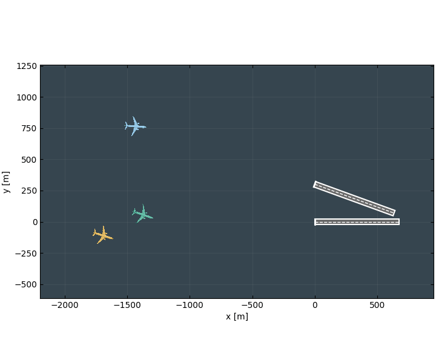
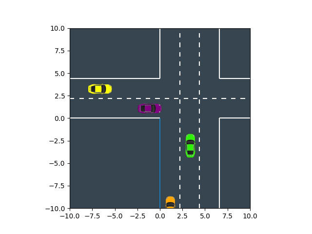
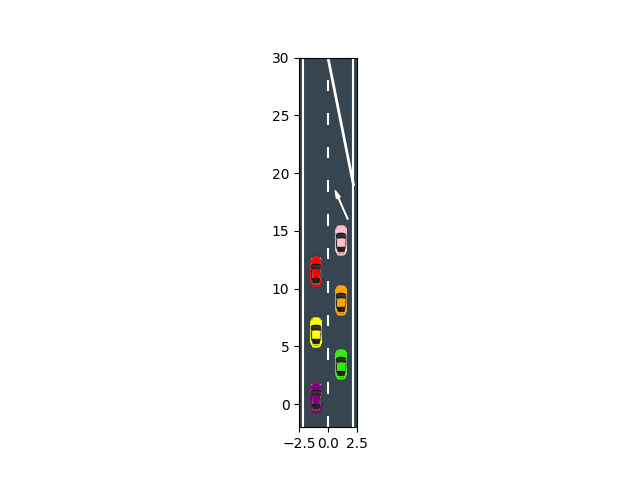
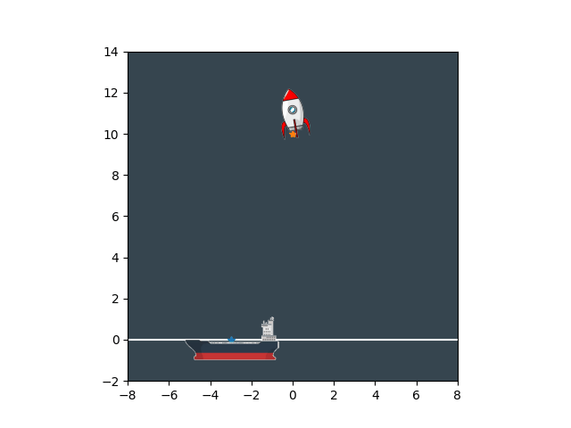

<div align="center">

# Constrained Potential Games

**Trajectory optimization for interacting dynamical systems**

CPS · Residual Descent Differential Dynamic Games (RD3G) · ALGames

[Installation](#installation) · [Single runs](#single-runs-and-visualizations) · [Benchmarks](#benchmarks) · [Experimental video](https://youtu.be/ZPHatstJqXc)

</div>

A research framework for constrained differential dynamic games, with CasADi
models, Python solvers, and C++ backends for CPS/IPM and RD3G. Three reproducible
comparison benchmarks cover **merge, intersection, and racing**. Additional game
implementations include air traffic control, rocket landing, drifting, and
tractor–trailer maneuvering.

## Run commands

| Game | Solve and visualize | Benchmark: 100 repeats per solver and car count |
| --- | --- | --- |
| Merge | `uv run python -m scripts.solve_merge --animate --initial` | `uv run python -m scripts.benchmark_merge` |
| Intersection | `uv run python -m scripts.solve_intersection --animate --initial` | `uv run python -m scripts.benchmark_intersection` |
| Racing | `uv run python -m scripts.solve_racing --animate --initial` | `uv run python -m scripts.benchmark_racing` |

## Gallery

<table>
  <tr><th colspan="2">Air traffic control · three aircraft</th></tr>
  <tr><td align="center">Initial guess</td><td align="center">Solution</td></tr>
  <tr>
    <td></td>
    <td></td>
  </tr>
  <tr><th colspan="2">Intersection · six cars</th></tr>
  <tr><td colspan="2" align="center"></td></tr>
  <tr><th colspan="2">Merge · six cars</th></tr>
  <tr><td align="center">Initial guess</td><td align="center">Solution</td></tr>
  <tr>
    <td></td>
    <td></td>
  </tr>
  <tr><th colspan="2">Rocket landing</th></tr>
  <tr><td align="center">Initial guess</td><td align="center">Solution</td></tr>
  <tr>
    <td></td>
    <td></td>
  </tr>
</table>

**Experimental video:** [Watch the experimental video →](https://youtu.be/ZPHatstJqXc)

## Installation

Use **Python 3.12**, [uv](https://docs.astral.sh/uv/), and a Linux toolchain with
C++17 support. Run all commands below from the repository root.

On Ubuntu / Debian:

```bash
sudo apt-get update
sudo apt-get install -y build-essential cmake pkg-config git \
    libeigen3-dev libsuitesparse-dev libsuperlu-dev
```

Initialize the bundled dependencies:

```bash
git submodule update --init --recursive
```

The racing game uses the **BuzzRacer** Python package and its survey-track assets.
The dependency configuration expects a sibling checkout at `../buzzracer`:

```text
parent/
├── hybrid/        # this repository
└── buzzracer/     # BuzzRacer source and assets/survey_track.p
```

If you do not already have that checkout:

```bash
git clone git@github.com:Nick-Zhang1996/RC-VIP.git ../buzzracer
```

Install the locked Python environment, including the development test tools:

```bash
uv sync --locked
```

### Build the C++ backends

Generate and compile the libraries used by all three benchmarks:

```bash
uv run python -m scripts.generate_casadi_code \
    --games merge intersection racing --solvers ipm rd3g \
    --min-cars 2 --max-cars 8 --horizon 20

uv run cmake -S cpp -B build -DPython_EXECUTABLE="$PWD/.venv/bin/python"
uv run cmake --build build --parallel 2
```

CMake uses spdlog 1.12 or newer when available, otherwise it fetches version
1.12.0. Generated sources live in `casadi_codegen/`; native modules and shared
libraries live in `build/lib/`. Both directories are local build artifacts.

Each **game × solver × car count × horizon** needs a matching generated library.
Regenerate and rebuild after changing game dynamics, costs, constraints, or
symbolic parameter layouts. For a smaller initial build, select one game and set
`--min-cars 2 --max-cars 2`. Both CPS and PDO use the `ipm` code-generation key.

### Set up the ALGames comparison

The ALGames adapter uses the benchmark implementation in the
`extern/AlgamesDriving.jl` submodule. Its pinned dependency graph uses **Julia 1.8**.
With Juliaup installed:

```bash
juliaup add 1.8
julia +1.8 --project=extern/AlgamesDriving.jl -e 'using Pkg; Pkg.instantiate()'
```

The adapter automatically prefers a Julia 1.8 installation under Juliaup. ALGames
runs in Julia; CPS and RD3G use the selected Python or C++ backend.

## Configuration

[config/experiments.toml](config/experiments.toml) defines the workload defaults
and solver settings used by the commands. It specifies 100 benchmark repeats,
car counts, horizon, iteration limit, tolerance, seed, and method configurations.
Command-line options override these defaults. A custom `--config PATH` file can
override any subset of the TOML settings:

```toml
[run]
iterations = 50
tolerance = 1e-5

[benchmark]
runs = 100
min_cars = 2
max_cars = 6
```

```bash
uv run python -m scripts.solve_merge --config my_experiment.toml --animate
uv run python -m scripts.benchmark_merge --config my_experiment.toml
```

Game models retain their physical parameters in the game configuration classes.
Benchmark statistics and plots are calculated from the measured runs.

## Single runs and visualizations

Run a seeded CPS solve and display its trajectories, convergence plot, and
animations of the initial guess and solution:

```bash
uv run python -m scripts.solve_merge \
    --car-count 6 --seed 0 --animate --initial

uv run python -m scripts.solve_intersection \
    --car-count 6 --animate --initial

uv run python -m scripts.solve_racing \
    --car-count 4 --seed 0 --animate --initial
```

All three commands accept the same options:

| Option | Behavior |
| --- | --- |
| `--solver cps` | CPS; also accepts `rd3g`, `algames`, `pdo`, `ipm`, and `ilqgame` |
| `--backend cpp` | C++ for CPS/IPM, PDO, and RD3G; use `python` to skip the native build |
| `--car-count N --horizon T` | Game size; C++ requires matching generated libraries |
| `--seed S --iterations K --tolerance E` | Initialization, iteration limit, and stopping tolerance |
| `--config PATH` | Experiment and solver settings from a TOML file |
| `--animate --initial` | Save solution and initial-guess GIFs |
| `--no-display` | Save visualizations without opening windows |
| `--output-dir PATH` | Choose where the run artifacts are saved |
| `--restarts K --restart-std S1 S2` | Extra C++ CPS/IPM/PDO guesses with per-control noise scales |

For example, run without a graphical display or native libraries:

```bash
uv run python -m scripts.solve_merge \
    --backend python --car-count 2 --no-display --animate --initial
```

Each run saves `solution.npz`, `solution.png`, and `residuals.png` under
`outputs/single_runs/<game>_<N>car_seed<S>/`. Optional animations are saved in the
same directory as `solution.gif` and `initial.gif`; `--initial` also saves
`initial.png`. Gallery GIFs remain separate from new run outputs.

For interactive windows, use a desktop Matplotlib backend. On a headless machine,
pass `--no-display`. The other game demos remain available as
`python -m scripts.solve_atc`, `scripts.solve_rocket_landing`,
`scripts.solve_drift`, and `scripts.solve_trailer` through `uv run`.

## Benchmarks

There are exactly **three benchmark entry points**, one per driving game. Each
compares **CPS, RD3G, and ALGames** over identical seeded physical initial
conditions:

```bash
uv run python -m scripts.benchmark_merge --runs 100
uv run python -m scripts.benchmark_intersection --runs 100
uv run python -m scripts.benchmark_racing --runs 100
```

Defaults are **2–8 cars**, a **20-step horizon**, **20 solver iterations**,
**tolerance `5e-4`**, and seeds **0–99**. No random restarts are used by default.
CPS and RD3G use the racing game's initial control guess; merge and intersection
start with zero controls. ALGames uses its own internal control initialization.

| Method | Configuration |
| --- | --- |
| **CPS** | IPM with `variational_gne=True`, `abs_split=True`, `precondition_with_potential=False`, `inertia_correction=False`, `inertia_correction_classic=True` |
| **RD3G** | CasADi RD3G with agent-specific GNE multipliers and inertia correction off |
| **ALGames** | Julia backend with a persistent worker and a warm-up solve |

PDO remains available in the solver code and single-run commands. It is excluded
from the comparison benchmarks.

### Small checks and custom sweeps

Check each benchmark with one two-car CPS solve:

```bash
uv run python -m scripts.benchmark_merge --solvers cps --runs 1 --min-cars 2 --max-cars 2
uv run python -m scripts.benchmark_intersection --solvers cps --runs 1 --min-cars 2 --max-cars 2
uv run python -m scripts.benchmark_racing --solvers cps --runs 1 --min-cars 2 --max-cars 2
```

Select comparison methods, seeds, and destinations without editing source files:

```bash
uv run python -m scripts.benchmark_merge \
    --solvers cps rd3g --runs 10 --seed 100 --min-cars 2 --max-cars 4 \
    --output-dir outputs/benchmarks/merge_custom
```

Use `--backend python` to run CPS and RD3G without compiling C++. Use `--show` to
display the generated comparison plot. To evaluate extra CPS control guesses,
select `--solvers cps --restarts K --restart-std S1 S2`, with noise scales in the
game's control order. The reported runtime includes all attempts.

### Results and interpretation

Each benchmark writes to `outputs/benchmarks/<game>/` by default:

| Artifact | Contents |
| --- | --- |
| `runs.csv` | One row per seeded solve, including timing, convergence, constraints, and errors |
| `runs.json` | Run records with available residual histories and restart attempts |
| `config.json` | Sweep arguments and complete solver settings |
| `summary.txt` | Runtime mean/std, convergence rate, optimality rate, and error counts |
| `comparison.png` | Timing and success-rate plots computed from that sweep |

Solve timings exclude code generation, solver construction, and post-solve
constraint/optimality diagnostics. Each backend reports its solve time. The
optimality rate counts runs that are **both converged and marked optimal**.
Optimality is reported when supplied by the solver. ALGames does not return this
flag, so its optimality fields are left empty and its summary displays `n/a`.

Use a new `--output-dir` to retain multiple sweeps: rerunning a benchmark in the
same directory replaces its report files. Existing local result directories are
not needed to reproduce a fresh benchmark.

## Repository layout

```text
rd3g/
├── core/           CasADi game and solver interfaces
├── games/          Game dynamics, costs, constraints, and renderers
├── solvers/        CPS/IPM, PDO, RD3G, ALGames, iLQGame, IPOPT, and Newton
├── resources/      Vehicle, aircraft, rocket, and ship graphics
└── utilities/      Code generation, profiling, and output paths
cpp/                Native IPM and RD3G solvers and CMake build
scripts/            Three benchmarks, single-run commands, and shared CLI support
extern/             pybind11 and the ALGames Julia backend
outputs/gifs/       Versioned README gallery; other outputs remain local
tests/              Current solver and game regression tests
```

## Tests

Run the focused regression suite:

```bash
uv run python -m pytest -m 'not slow'
```

The optional statistical PDO regression sweeps perform hundreds of Python and
C++ solves and require matching three-car merge libraries:

```bash
uv run python -m pytest -m slow
```
